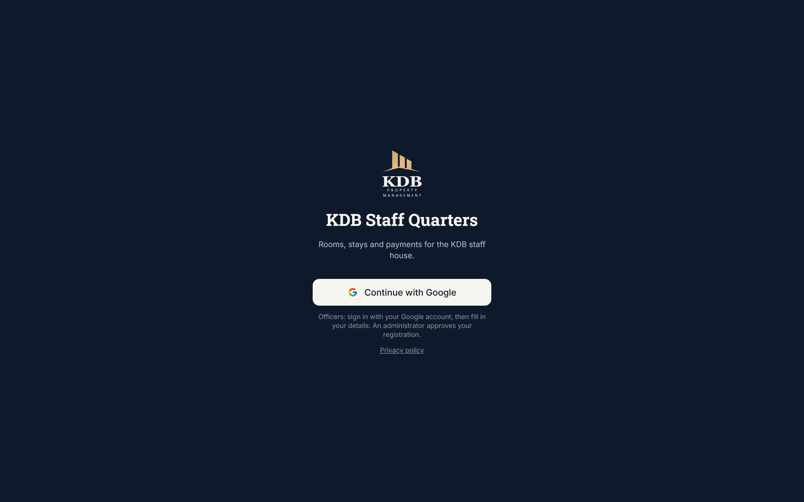
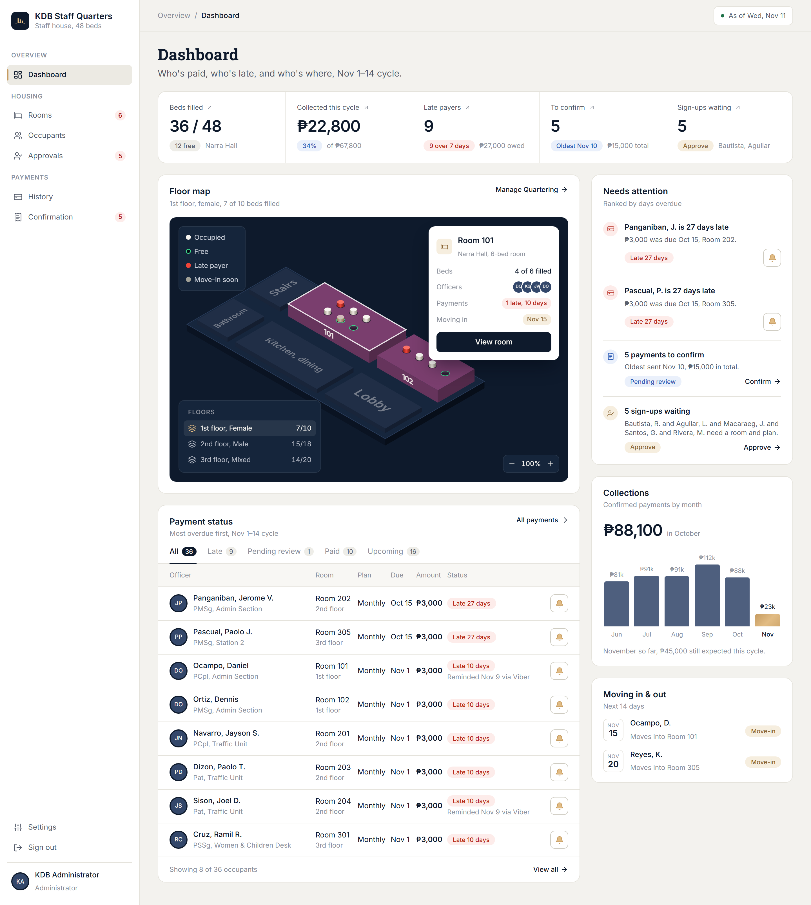
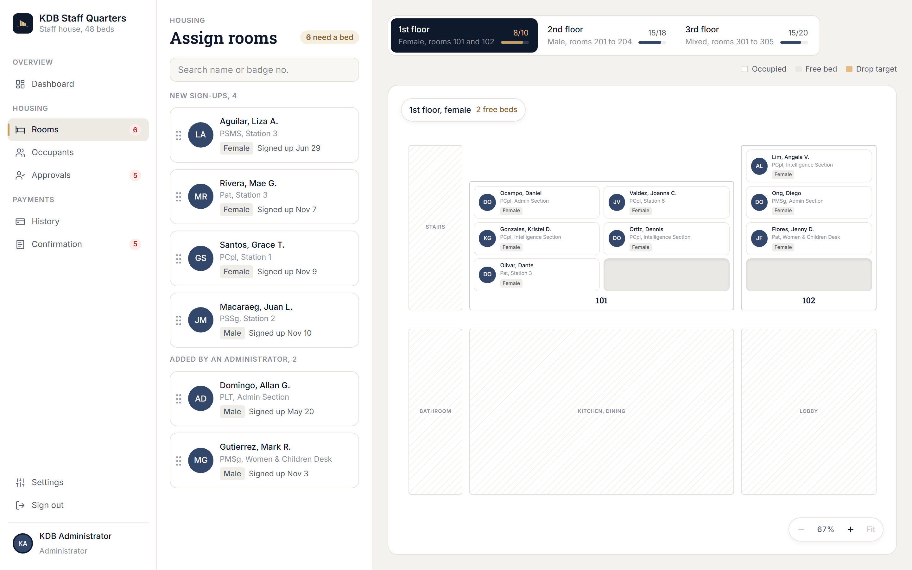
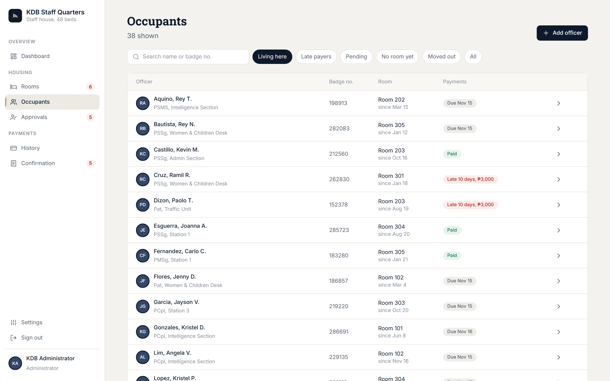
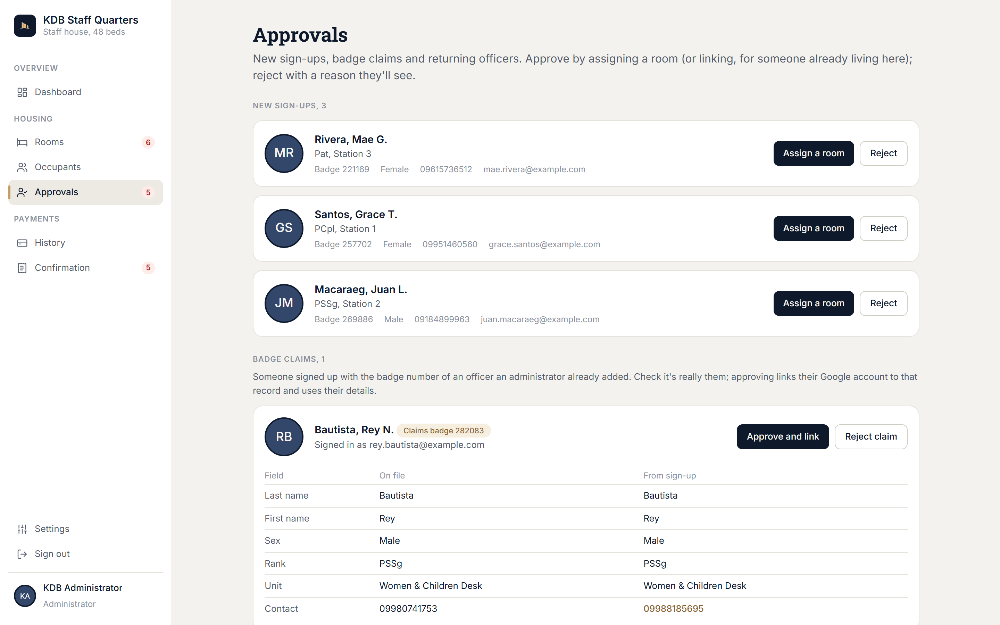
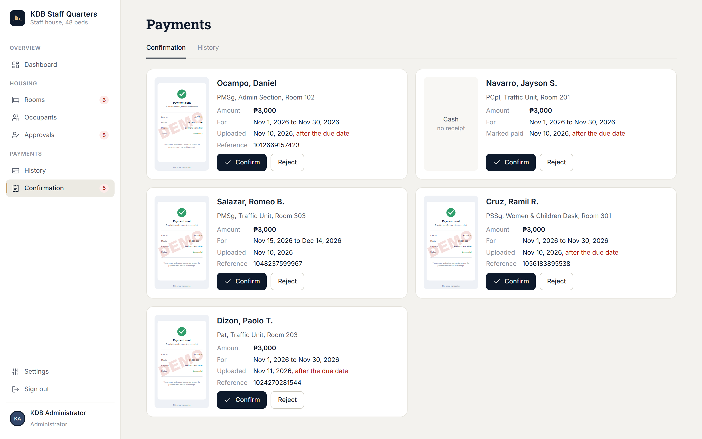
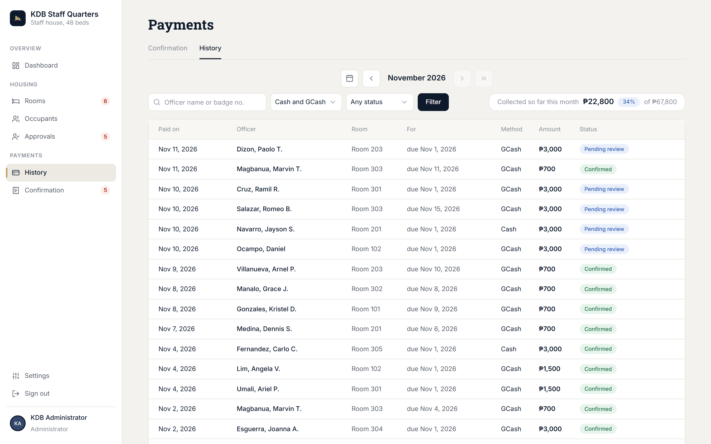
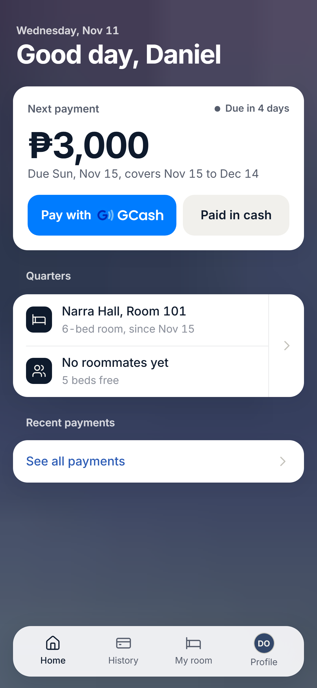
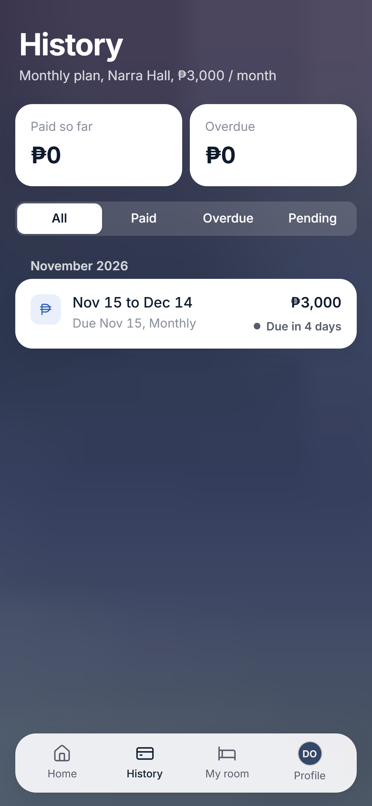
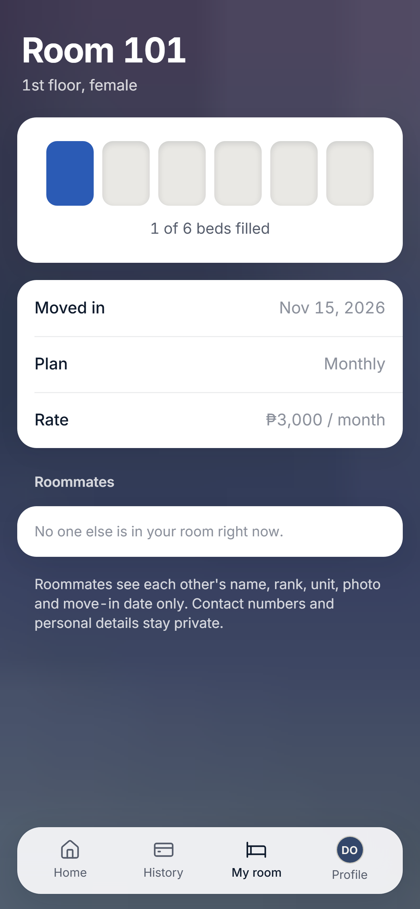

# KDB Quarters

**Rooms, stays and payments for a staff house, in one app instead of a notebook and a Viber thread**

### [Try the live demo →](https://kdb-quarters-demo.vercel.app/login/)

[The problem](#the-problem) · [The solution](#the-solution) · [The results](#the-results) · [Screenshots](#screenshots) · [Tech stack](#tech-stack)

> [!NOTE]
> KDB Quarters is a **solo project** I built for my family's business, KDB Property Management. The production app and its source code are private. The [live demo](https://kdb-quarters-demo.vercel.app/login/) runs the same screens with made-up people and a fictional floor map, so you can sign in as a manager or an officer without an account. The [screenshots](#screenshots) below come from it too, apart from the sign-in screen, which is the production app's.

## The problem

KDB Property Management rents beds to Philippine National Police officers: 58 beds across two staff houses. Every stay and payment was tracked in a paper notebook, and payments were confirmed in a group chat.

- **Rent was worked out by hand.** Officers pay weekly, every half month or monthly, in advance, and anyone moving in mid-period owes a prorated amount. Each charge was calculated manually.
- **No one had the full picture.** Finding a free bed, or knowing who was late, meant flipping through the notebook and scrolling the chat.
- **Proof of payment was scattered.** GCash receipts were screenshots in a Viber thread, with nothing tying them to a charge.

## The solution

A web app with two sides: one for the managers who run the houses and one for the officers who live there.

**For managers**

- **Dashboard:** beds filled, collected against expected for the current period, late occupants, receipts and sign-ups waiting, move-ins and move-outs in the next 14 days, and a six-month income chart you can click into.
- **Room assignment:** drag an officer onto a free bed on an interactive floor map, or tap through a list on a phone. Capacity and occupancy rules are checked during the drag, the first charge is previewed before you confirm, and Undo puts everything back.
- **Moves and switches:** drag a housed officer to another room, or onto another officer to swap rooms. Billing continues at the new room's rate.
- **Payments:** review GCash receipts, confirm them or reject them with a reason, record cash payments, and browse the history by month.
- **Late payers:** a Remind button with a ready-made message for Viber or SMS, plus dated notes on each occupant.

**For officers**

- Google sign-in, a sign-up form, and a waiting screen until a manager approves them.
- Their room, roommates and next payment at a glance, with a notice when something is overdue.
- Pay a charge by uploading a GCash receipt, or mark it as paid in cash for a manager to confirm.

**Billing that runs itself.** Weekly, half-month and monthly plans are paid in advance. A move-in that isn't on the 1st or the 15th is prorated up to the next one. A scheduled job runs every day and issues the coming charges, so no one calculates rent by hand.

## The results

- Replaced the notebook and the group chat with one production app that tracks rooms, stays and payments for **58 beds across 2 staff houses**.
- **Ended manual rent calculation:** a daily scheduled job issues advance charges for weekly, half-month and monthly plans and prorates mid-period move-ins.
- **Room assignment takes one drag** on the floor map, which checks capacity and occupancy rules as you drag and previews the first charge.

## Screenshots

**Sign-in.** Managers and officers sign in with Google.

### Manager

**Dashboard.** Beds filled, collections for the cycle, late payers, what's waiting for confirmation, a floor map preview and a six-month income chart.

**Room assignment.** New sign-ups on the left; drag one onto a free bed on the floor plan.

<table>
  <tr>
    <td width="50%"><b>Occupants</b>, with filters for late payers, pending and moved out  </td>
    <td width="50%"><b>Approvals</b> for new sign-ups and badge claims  </td>
  </tr>
  <tr>
    <td width="50%"><b>Payment confirmation</b>: confirm or reject GCash receipts and cash payments  </td>
    <td width="50%"><b>Payment history</b> by month  </td>
  </tr>
</table>

### Officer

Built for the phone: the next payment with GCash or cash, the payment history, and their room.

<table>
  <tr>
    <td width="33%"></td>
    <td width="33%"></td>
    <td width="33%"></td>
  </tr>
</table>

## Tech stack

| Layer | Choice |
| --- | --- |
| App | Next.js 16 (App Router, server actions), React 19, Tailwind CSS 4 |
| Data and auth | Supabase: Postgres with row-level security, Google sign-in, private storage for receipts and photos |
| Hosting | Vercel in Singapore (`sin1`, next to the database), with Vercel Cron for daily charges |
| Tests | Vitest (business rules), pgTAP (row-level security), Playwright (UI), a scripted smoke test |

**App.** Next.js handles both sides of the app. Manager and officer screens live in separate sections of the app, and every write goes through a server action that validates its input with Zod before it touches the database.

**Data and auth.** Officers sign in with Google. Row-level security in Postgres means an officer can only ever read their own room, charges and receipts, however the request is made. Receipts and profile photos are kept in private storage buckets.

**Billing.** The billing rules are plain TypeScript functions with unit tests: plans, proration and charge status. A Vercel Cron job calls a protected route every midnight (Manila time) that creates the next charges.

**Hosting.** The app and the database both run in Singapore, which keeps every request close to the users in the Philippines.
